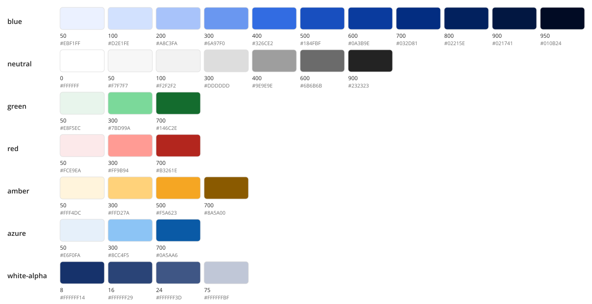
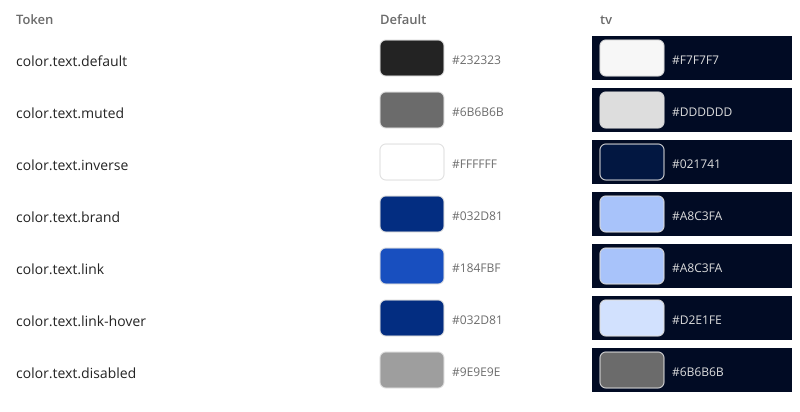
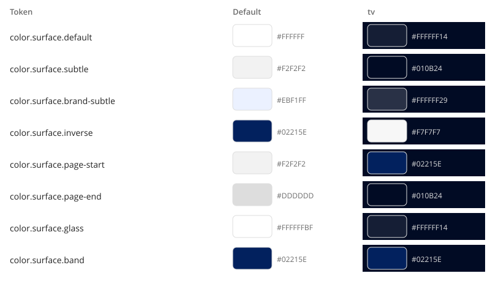
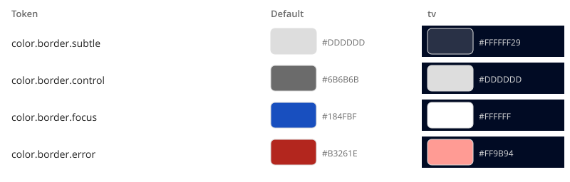
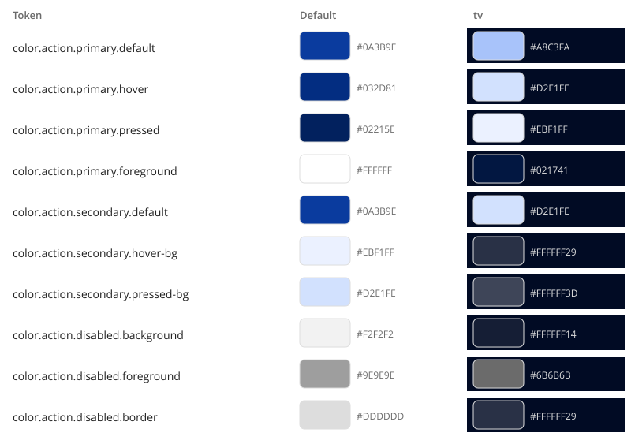
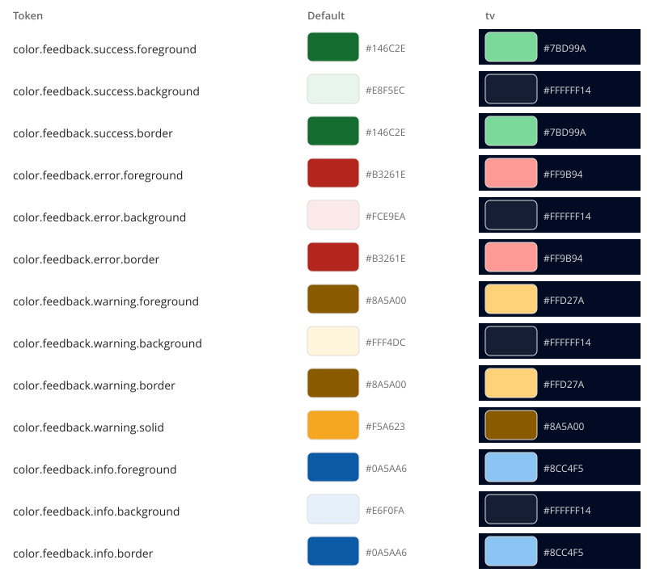
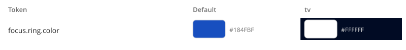

<!-- Generated by packages/tokens/scripts/build-docs.mjs from tokens.json. Do not edit by hand. -->
# Colors

Every color is a variable. Pick by **meaning** (system tokens), never by hex. Same names in Figma (`system/color/text/default`) and CSS (`var(--color-text-default)`).

## How to choose a color

1. Pages and layouts: use **system** colors (`color.text.*`, `color.surface.*`, `color.border.*`, `color.action.*`, `color.feedback.*`).
2. Inside a component: use its **component** tokens (`button.primary.background`); they point to system.
3. Never use **reference** colors (`color.blue.600`) in screens or components; they only feed system tokens.
4. Text on any surface must pass 4.5:1; borders and focus 3:1. The pairs below are checked on every pull request.
5. Dark areas (TV, title band) are not new colors: the same tokens switch to the **tv** mode.

## Reference palette

Raw values. Only system tokens point to them.

| Token | Hex | CSS |
|---|---|---|
| `color.blue.50` | `#EBF1FF` | `--color-blue-50` |
| `color.blue.100` | `#D2E1FE` | `--color-blue-100` |
| `color.blue.200` | `#A8C3FA` | `--color-blue-200` |
| `color.blue.300` | `#6A97F0` | `--color-blue-300` |
| `color.blue.400` | `#326CE2` | `--color-blue-400` |
| `color.blue.500` | `#184FBF` | `--color-blue-500` |
| `color.blue.600` | `#0A3B9E` | `--color-blue-600` |
| `color.blue.700` | `#032D81` | `--color-blue-700` |
| `color.blue.800` | `#02215E` | `--color-blue-800` |
| `color.blue.900` | `#021741` | `--color-blue-900` |
| `color.blue.950` | `#010B24` | `--color-blue-950` |
| `color.neutral.0` | `#FFFFFF` | `--color-neutral-0` |
| `color.neutral.50` | `#F7F7F7` | `--color-neutral-50` |
| `color.neutral.100` | `#F2F2F2` | `--color-neutral-100` |
| `color.neutral.300` | `#DDDDDD` | `--color-neutral-300` |
| `color.neutral.400` | `#9E9E9E` | `--color-neutral-400` |
| `color.neutral.600` | `#6B6B6B` | `--color-neutral-600` |
| `color.neutral.900` | `#232323` | `--color-neutral-900` |
| `color.green.50` | `#E8F5EC` | `--color-green-50` |
| `color.green.300` | `#7BD99A` | `--color-green-300` |
| `color.green.700` | `#146C2E` | `--color-green-700` |
| `color.red.50` | `#FCE9EA` | `--color-red-50` |
| `color.red.300` | `#FF9B94` | `--color-red-300` |
| `color.red.700` | `#B3261E` | `--color-red-700` |
| `color.amber.50` | `#FFF4DC` | `--color-amber-50` |
| `color.amber.300` | `#FFD27A` | `--color-amber-300` |
| `color.amber.500` | `#F5A623` | `--color-amber-500` |
| `color.amber.700` | `#8A5A00` | `--color-amber-700` |
| `color.azure.50` | `#E6F0FA` | `--color-azure-50` |
| `color.azure.300` | `#8CC4F5` | `--color-azure-300` |
| `color.azure.700` | `#0A5AA6` | `--color-azure-700` |
| `color.white-alpha.8` | `#FFFFFF14` | `--color-white-alpha-8` |
| `color.white-alpha.16` | `#FFFFFF29` | `--color-white-alpha-16` |
| `color.white-alpha.24` | `#FFFFFF3D` | `--color-white-alpha-24` |
| `color.white-alpha.75` | `#FFFFFFBF` | `--color-white-alpha-75` |

## System colors

Meaning. Use these in pages and components. Each row shows the default mode and the tv mode.

### Text

Text and icons. Never use a surface or border color for text.

| Token | Default | tv | Points to | Use |
|---|---|---|---|---|
| `color.text.default` | `#232323` | `#F7F7F7` | `color.neutral.900` · tv: `color.neutral.50` |  |
| `color.text.muted` | `#6B6B6B` | `#DDDDDD` | `color.neutral.600` · tv: `color.neutral.300` | Not on blue 100 or darker. |
| `color.text.inverse` | `#FFFFFF` | `#021741` | `color.neutral.0` · tv: `color.blue.900` |  |
| `color.text.brand` | `#032D81` | `#A8C3FA` | `color.blue.700` · tv: `color.blue.200` |  |
| `color.text.link` | `#184FBF` | `#A8C3FA` | `color.blue.500` · tv: `color.blue.200` |  |
| `color.text.link-hover` | `#032D81` | `#D2E1FE` | `color.blue.700` · tv: `color.blue.100` |  |
| `color.text.disabled` | `#9E9E9E` | `#6B6B6B` | `color.neutral.400` · tv: `color.neutral.600` | Exempt from contrast requirements. |

### Surface

Backgrounds: page canvas, panels, glass cards and the navy title band.

| Token | Default | tv | Points to | Use |
|---|---|---|---|---|
| `color.surface.default` | `#FFFFFF` | `#FFFFFF14` | `color.neutral.0` · tv: `color.white-alpha.8` |  |
| `color.surface.subtle` | `#F2F2F2` | `#010B24` | `color.neutral.100` · tv: `color.blue.950` |  |
| `color.surface.brand-subtle` | `#EBF1FF` | `#FFFFFF29` | `color.blue.50` · tv: `color.white-alpha.16` |  |
| `color.surface.inverse` | `#02215E` | `#F7F7F7` | `color.blue.800` · tv: `color.neutral.50` |  |
| `color.surface.page-start` | `#F2F2F2` | `#02215E` | `color.neutral.100` · tv: `color.blue.800` | Page background, gradient start. |
| `color.surface.page-end` | `#DDDDDD` | `#010B24` | `color.neutral.300` · tv: `color.blue.950` | Page background, gradient end. |
| `color.surface.glass` | `#FFFFFFBF` | `#FFFFFF14` | `color.white-alpha.75` · tv: `color.white-alpha.8` | Raised panels over the page gradient. |
| `color.surface.band` | `#02215E` | `#02215E` | `color.blue.800` · tv: `color.blue.800` | Page title band; use with the frame in tv mode. |

### Border

Lines around controls, panels and the focus ring.

| Token | Default | tv | Points to | Use |
|---|---|---|---|---|
| `color.border.subtle` | `#DDDDDD` | `#FFFFFF29` | `color.neutral.300` · tv: `color.white-alpha.16` | Decorative; does not identify controls. |
| `color.border.control` | `#6B6B6B` | `#DDDDDD` | `color.neutral.600` · tv: `color.neutral.300` | Outline of fields and controls. |
| `color.border.focus` | `#184FBF` | `#FFFFFF` | `color.blue.500` · tv: `color.neutral.0` |  |
| `color.border.error` | `#B3261E` | `#FF9B94` | `color.red.700` · tv: `color.red.300` |  |

### Action

Interactive elements: buttons and links in their states.

| Token | Default | tv | Points to | Use |
|---|---|---|---|---|
| `color.action.primary.default` | `#0A3B9E` | `#A8C3FA` | `color.blue.600` · tv: `color.blue.200` |  |
| `color.action.primary.hover` | `#032D81` | `#D2E1FE` | `color.blue.700` · tv: `color.blue.100` |  |
| `color.action.primary.pressed` | `#02215E` | `#EBF1FF` | `color.blue.800` · tv: `color.blue.50` |  |
| `color.action.primary.foreground` | `#FFFFFF` | `#021741` | `color.neutral.0` · tv: `color.blue.900` |  |
| `color.action.secondary.default` | `#0A3B9E` | `#D2E1FE` | `color.blue.600` · tv: `color.blue.100` |  |
| `color.action.secondary.hover-bg` | `#EBF1FF` | `#FFFFFF29` | `color.blue.50` · tv: `color.white-alpha.16` |  |
| `color.action.secondary.pressed-bg` | `#D2E1FE` | `#FFFFFF3D` | `color.blue.100` · tv: `color.white-alpha.24` |  |
| `color.action.disabled.background` | `#F2F2F2` | `#FFFFFF14` | `color.neutral.100` · tv: `color.white-alpha.8` |  |
| `color.action.disabled.foreground` | `#9E9E9E` | `#6B6B6B` | `color.neutral.400` · tv: `color.neutral.600` |  |
| `color.action.disabled.border` | `#DDDDDD` | `#FFFFFF29` | `color.neutral.300` · tv: `color.white-alpha.16` |  |

### Feedback

Status messages. Always paired with text or an icon, never color alone.

| Token | Default | tv | Points to | Use |
|---|---|---|---|---|
| `color.feedback.success.foreground` | `#146C2E` | `#7BD99A` | `color.green.700` · tv: `color.green.300` |  |
| `color.feedback.success.background` | `#E8F5EC` | `#FFFFFF14` | `color.green.50` · tv: `color.white-alpha.8` |  |
| `color.feedback.success.border` | `#146C2E` | `#7BD99A` | `color.green.700` · tv: `color.green.300` |  |
| `color.feedback.error.foreground` | `#B3261E` | `#FF9B94` | `color.red.700` · tv: `color.red.300` |  |
| `color.feedback.error.background` | `#FCE9EA` | `#FFFFFF14` | `color.red.50` · tv: `color.white-alpha.8` |  |
| `color.feedback.error.border` | `#B3261E` | `#FF9B94` | `color.red.700` · tv: `color.red.300` |  |
| `color.feedback.warning.foreground` | `#8A5A00` | `#FFD27A` | `color.amber.700` · tv: `color.amber.300` |  |
| `color.feedback.warning.background` | `#FFF4DC` | `#FFFFFF14` | `color.amber.50` · tv: `color.white-alpha.8` |  |
| `color.feedback.warning.border` | `#8A5A00` | `#FFD27A` | `color.amber.700` · tv: `color.amber.300` |  |
| `color.feedback.warning.solid` | `#F5A623` | `#8A5A00` | `color.amber.500` · tv: `color.amber.700` | With text.default on top; never sole indicator. |
| `color.feedback.info.foreground` | `#0A5AA6` | `#8CC4F5` | `color.azure.700` · tv: `color.azure.300` |  |
| `color.feedback.info.background` | `#E6F0FA` | `#FFFFFF14` | `color.azure.50` · tv: `color.white-alpha.8` |  |
| `color.feedback.info.border` | `#0A5AA6` | `#8CC4F5` | `color.azure.700` · tv: `color.azure.300` |  |

### Focus

The focus ring: always visible, 3:1 against what is behind it.

| Token | Default | tv | Points to | Use |
|---|---|---|---|---|
| `focus.ring.color` | `#184FBF` | `#FFFFFF` | `color.border.focus` |  |

## Component colors

Decisions of one component. Use only inside that component.

| Token | Default | tv | Points to |
|---|---|---|---|
| `button.primary.background` | `#0A3B9E` | `#A8C3FA` | `color.action.primary.default` |
| `button.primary.background-hover` | `#032D81` | `#D2E1FE` | `color.action.primary.hover` |
| `button.primary.background-pressed` | `#02215E` | `#EBF1FF` | `color.action.primary.pressed` |
| `button.primary.foreground` | `#FFFFFF` | `#021741` | `color.action.primary.foreground` |
| `button.secondary.background` | `#FFFFFF` | `#FFFFFF14` | `color.surface.default` |
| `button.secondary.background-hover` | `#EBF1FF` | `#FFFFFF29` | `color.action.secondary.hover-bg` |
| `button.secondary.background-pressed` | `#D2E1FE` | `#FFFFFF3D` | `color.action.secondary.pressed-bg` |
| `button.secondary.foreground` | `#0A3B9E` | `#D2E1FE` | `color.action.secondary.default` |
| `button.secondary.border` | `#0A3B9E` | `#D2E1FE` | `color.action.secondary.default` |
| `checkbox.background-checked` | `#0A3B9E` | `#A8C3FA` | `color.action.primary.default` |
| `checkbox.border-checked` | `#0A3B9E` | `#A8C3FA` | `color.action.primary.default` |
| `checkbox.checkmark` | `#FFFFFF` | `#021741` | `color.action.primary.foreground` |
| `checkbox.disabled.border` | `#9E9E9E` | `#6B6B6B` | `color.action.disabled.foreground` |
| `checkbox.disabled.label` | `#9E9E9E` | `#6B6B6B` | `color.text.disabled` |
| `checkbox.disabled.background-checked` | `#9E9E9E` | `#6B6B6B` | `color.action.disabled.foreground` |
| `radio.border-checked` | `#0A3B9E` | `#A8C3FA` | `color.action.primary.default` |
| `radio.dot` | `#0A3B9E` | `#A8C3FA` | `color.action.primary.default` |
| `radio.disabled.border` | `#9E9E9E` | `#6B6B6B` | `color.action.disabled.foreground` |
| `radio.disabled.label` | `#9E9E9E` | `#6B6B6B` | `color.text.disabled` |
| `radio.disabled.dot` | `#9E9E9E` | `#6B6B6B` | `color.action.disabled.foreground` |
| `tag.neutral.background` | `#F2F2F2` | `#010B24` | `color.surface.subtle` |
| `tag.neutral.foreground` | `#232323` | `#F7F7F7` | `color.text.default` |
| `tag.brand.background` | `#EBF1FF` | `#FFFFFF29` | `color.surface.brand-subtle` |
| `tag.brand.foreground` | `#032D81` | `#A8C3FA` | `color.text.brand` |
| `tag.success.background` | `#E8F5EC` | `#FFFFFF14` | `color.feedback.success.background` |
| `tag.success.foreground` | `#146C2E` | `#7BD99A` | `color.feedback.success.foreground` |
| `tag.error.background` | `#FCE9EA` | `#FFFFFF14` | `color.feedback.error.background` |
| `tag.error.foreground` | `#B3261E` | `#FF9B94` | `color.feedback.error.foreground` |
| `tag.warning.background` | `#FFF4DC` | `#FFFFFF14` | `color.feedback.warning.background` |
| `tag.warning.foreground` | `#8A5A00` | `#FFD27A` | `color.feedback.warning.foreground` |
| `tag.info.background` | `#E6F0FA` | `#FFFFFF14` | `color.feedback.info.background` |
| `tag.info.foreground` | `#0A5AA6` | `#8CC4F5` | `color.feedback.info.foreground` |
| `notification-banner.info.background` | `#E6F0FA` | `#FFFFFF14` | `color.feedback.info.background` |
| `notification-banner.info.border` | `#0A5AA6` | `#8CC4F5` | `color.feedback.info.border` |
| `notification-banner.info.icon` | `#0A5AA6` | `#8CC4F5` | `color.feedback.info.foreground` |
| `notification-banner.success.background` | `#E8F5EC` | `#FFFFFF14` | `color.feedback.success.background` |
| `notification-banner.success.border` | `#146C2E` | `#7BD99A` | `color.feedback.success.border` |
| `notification-banner.success.icon` | `#146C2E` | `#7BD99A` | `color.feedback.success.foreground` |
| `notification-banner.warning.background` | `#FFF4DC` | `#FFFFFF14` | `color.feedback.warning.background` |
| `notification-banner.warning.border` | `#8A5A00` | `#FFD27A` | `color.feedback.warning.border` |
| `notification-banner.warning.icon` | `#8A5A00` | `#FFD27A` | `color.feedback.warning.foreground` |
| `notification-banner.error.background` | `#FCE9EA` | `#FFFFFF14` | `color.feedback.error.background` |
| `notification-banner.error.border` | `#B3261E` | `#FF9B94` | `color.feedback.error.border` |
| `notification-banner.error.icon` | `#B3261E` | `#FF9B94` | `color.feedback.error.foreground` |
| `card.border-hover` | `#0A3B9E` | `#A8C3FA` | `color.action.primary.default` |

## Contrast (checked automatically)

WCAG 2.2: text 4.5:1 (1.4.3), UI components and focus 3:1 (1.4.11). Translucent colors are flattened over the lightest page background of the mode. Source: `npm test` in packages/tokens.

| Mode | Pair | Ratio | Minimum | Result |
|---|---|---|---|---|
| default | color.text.default on color.surface.default | 15.72:1 | 4.5:1 | Pass |
| default | color.text.muted on color.surface.default | 5.33:1 | 4.5:1 | Pass |
| default | color.text.link on color.surface.default | 7.22:1 | 4.5:1 | Pass |
| default | color.text.brand on color.surface.default | 12.38:1 | 4.5:1 | Pass |
| default | color.text.default on color.surface.subtle | 14.04:1 | 4.5:1 | Pass |
| default | color.text.muted on color.surface.subtle | 4.76:1 | 4.5:1 | Pass |
| default | color.text.link on color.surface.subtle | 6.45:1 | 4.5:1 | Pass |
| default | color.text.brand on color.surface.subtle | 11.06:1 | 4.5:1 | Pass |
| default | color.text.default on color.surface.brand-subtle | 13.89:1 | 4.5:1 | Pass |
| default | color.text.muted on color.surface.brand-subtle | 4.71:1 | 4.5:1 | Pass |
| default | color.text.link on color.surface.brand-subtle | 6.38:1 | 4.5:1 | Pass |
| default | color.text.brand on color.surface.brand-subtle | 10.94:1 | 4.5:1 | Pass |
| default | text.inverse on surface.inverse | 15.20:1 | 4.5:1 | Pass |
| default | text.link-hover on surface.default | 12.38:1 | 4.5:1 | Pass |
| default | button.primary foreground on background | 9.85:1 | 4.5:1 | Pass |
| default | button.secondary foreground on background | 9.85:1 | 4.5:1 | Pass |
| default | button.primary foreground on background-hover | 12.38:1 | 4.5:1 | Pass |
| default | button.secondary foreground on background-hover | 8.70:1 | 4.5:1 | Pass |
| default | button.primary foreground on background-pressed | 15.20:1 | 4.5:1 | Pass |
| default | button.secondary foreground on background-pressed | 7.48:1 | 4.5:1 | Pass |
| default | button.secondary border on surface.default | 9.85:1 | 3:1 | Pass |
| default | button.primary background on surface.default | 9.85:1 | 3:1 | Pass |
| default | text-input border on surface.default | 5.33:1 | 3:1 | Pass |
| default | text-input border on surface.subtle | 4.76:1 | 3:1 | Pass |
| default | text-input error border on surface.default | 6.54:1 | 3:1 | Pass |
| default | text-input focus on surface.default | 7.22:1 | 3:1 | Pass |
| default | text-input text on background | 15.72:1 | 4.5:1 | Pass |
| default | select border on surface.default | 5.33:1 | 3:1 | Pass |
| default | select border on surface.subtle | 4.76:1 | 3:1 | Pass |
| default | select error border on surface.default | 6.54:1 | 3:1 | Pass |
| default | select focus on surface.default | 7.22:1 | 3:1 | Pass |
| default | select text on background | 15.72:1 | 4.5:1 | Pass |
| default | text-input placeholder on background | 5.33:1 | 4.5:1 | Pass |
| default | text-input hint on surface.default | 5.33:1 | 4.5:1 | Pass |
| default | select icon on background | 15.72:1 | 3:1 | Pass |
| default | checkbox border on background | 5.33:1 | 3:1 | Pass |
| default | checkbox checked: background on superficie | 9.85:1 | 3:1 | Pass |
| default | checkbox checkmark on checked background | 9.85:1 | 3:1 | Pass |
| default | checkbox label on surface.default | 15.72:1 | 4.5:1 | Pass |
| default | checkbox focus on surface.default | 7.22:1 | 3:1 | Pass |
| default | radio border on background | 5.33:1 | 3:1 | Pass |
| default | radio checked: border on superficie | 9.85:1 | 3:1 | Pass |
| default | radio dot on background | 9.85:1 | 3:1 | Pass |
| default | radio label on surface.default | 15.72:1 | 4.5:1 | Pass |
| default | checkbox error border on surface.default | 6.54:1 | 3:1 | Pass |
| default | radio error border on surface.default | 6.54:1 | 3:1 | Pass |
| default | select hint on surface.default | 5.33:1 | 4.5:1 | Pass |
| default | radio focus on surface.default | 7.22:1 | 3:1 | Pass |
| default | tag.neutral text on background | 14.04:1 | 4.5:1 | Pass |
| default | tag.brand text on background | 10.94:1 | 4.5:1 | Pass |
| default | tag.success text on background | 5.82:1 | 4.5:1 | Pass |
| default | tag.error text on background | 5.60:1 | 4.5:1 | Pass |
| default | tag.warning text on background | 5.43:1 | 4.5:1 | Pass |
| default | tag.info text on background | 6.02:1 | 4.5:1 | Pass |
| default | banner.info text on background | 13.63:1 | 4.5:1 | Pass |
| default | banner.info border on surface.default | 6.94:1 | 3:1 | Pass |
| default | banner.info icon on background | 6.02:1 | 3:1 | Pass |
| default | banner.success text on background | 14.00:1 | 4.5:1 | Pass |
| default | banner.success border on surface.default | 6.53:1 | 3:1 | Pass |
| default | banner.success icon on background | 5.82:1 | 3:1 | Pass |
| default | banner.warning text on background | 14.39:1 | 4.5:1 | Pass |
| default | banner.warning border on surface.default | 5.93:1 | 3:1 | Pass |
| default | banner.warning icon on background | 5.43:1 | 3:1 | Pass |
| default | banner.error text on background | 13.46:1 | 4.5:1 | Pass |
| default | banner.error border on surface.default | 6.54:1 | 3:1 | Pass |
| default | banner.error icon on background | 5.60:1 | 3:1 | Pass |
| default | card title on background | 15.72:1 | 4.5:1 | Pass |
| default | card body on background | 15.72:1 | 4.5:1 | Pass |
| default | card hover border on background | 9.85:1 | 3:1 | Pass |
| default | error-message on surface.default | 6.54:1 | 4.5:1 | Pass |
| default | error-message on surface.subtle | 5.84:1 | 4.5:1 | Pass |
| default | color.text.default on surface.glass | 15.32:1 | 4.5:1 | Pass |
| default | color.text.muted on surface.glass | 5.19:1 | 4.5:1 | Pass |
| default | color.text.link on surface.glass | 7.04:1 | 4.5:1 | Pass |
| default | color.feedback.success.foreground on surface.glass | 6.37:1 | 4.5:1 | Pass |
| default | color.feedback.error.foreground on surface.glass | 6.37:1 | 4.5:1 | Pass |
| default | feedback.warning.solid with text.default on top | 7.75:1 | 4.5:1 | Pass |
| tv | color.text.default on color.surface.default | 11.51:1 | 4.5:1 | Pass |
| tv | color.text.muted on color.surface.default | 9.08:1 | 4.5:1 | Pass |
| tv | color.text.link on color.surface.default | 6.96:1 | 4.5:1 | Pass |
| tv | color.text.brand on color.surface.default | 6.96:1 | 4.5:1 | Pass |
| tv | color.text.default on color.surface.subtle | 18.24:1 | 4.5:1 | Pass |
| tv | color.text.muted on color.surface.subtle | 14.39:1 | 4.5:1 | Pass |
| tv | color.text.link on color.surface.subtle | 11.03:1 | 4.5:1 | Pass |
| tv | color.text.brand on color.surface.subtle | 11.03:1 | 4.5:1 | Pass |
| tv | color.text.default on color.surface.brand-subtle | 8.81:1 | 4.5:1 | Pass |
| tv | color.text.muted on color.surface.brand-subtle | 6.95:1 | 4.5:1 | Pass |
| tv | color.text.link on color.surface.brand-subtle | 5.33:1 | 4.5:1 | Pass |
| tv | color.text.brand on color.surface.brand-subtle | 5.33:1 | 4.5:1 | Pass |
| tv | text.inverse on surface.inverse | 16.32:1 | 4.5:1 | Pass |
| tv | text.link-hover on surface.default | 9.36:1 | 4.5:1 | Pass |
| tv | button.primary foreground on background | 9.86:1 | 4.5:1 | Pass |
| tv | button.secondary foreground on background | 9.36:1 | 4.5:1 | Pass |
| tv | button.primary foreground on background-hover | 13.27:1 | 4.5:1 | Pass |
| tv | button.secondary foreground on background-hover | 7.16:1 | 4.5:1 | Pass |
| tv | button.primary foreground on background-pressed | 15.45:1 | 4.5:1 | Pass |
| tv | button.secondary foreground on background-pressed | 5.53:1 | 4.5:1 | Pass |
| tv | button.secondary border on surface.default | 9.36:1 | 3:1 | Pass |
| tv | button.primary background on surface.default | 6.96:1 | 3:1 | Pass |
| tv | text-input border on surface.default | 9.08:1 | 3:1 | Pass |
| tv | text-input border on surface.subtle | 14.39:1 | 3:1 | Pass |
| tv | text-input error border on surface.default | 6.09:1 | 3:1 | Pass |
| tv | text-input focus on surface.default | 12.33:1 | 3:1 | Pass |
| tv | text-input text on background | 11.51:1 | 4.5:1 | Pass |
| tv | select border on surface.default | 9.08:1 | 3:1 | Pass |
| tv | select border on surface.subtle | 14.39:1 | 3:1 | Pass |
| tv | select error border on surface.default | 6.09:1 | 3:1 | Pass |
| tv | select focus on surface.default | 12.33:1 | 3:1 | Pass |
| tv | select text on background | 11.51:1 | 4.5:1 | Pass |
| tv | text-input placeholder on background | 9.08:1 | 4.5:1 | Pass |
| tv | text-input hint on surface.default | 9.08:1 | 4.5:1 | Pass |
| tv | select icon on background | 11.51:1 | 3:1 | Pass |
| tv | checkbox border on background | 9.08:1 | 3:1 | Pass |
| tv | checkbox checked: background on superficie | 6.96:1 | 3:1 | Pass |
| tv | checkbox checkmark on checked background | 9.86:1 | 3:1 | Pass |
| tv | checkbox label on surface.default | 11.51:1 | 4.5:1 | Pass |
| tv | checkbox focus on surface.default | 12.33:1 | 3:1 | Pass |
| tv | radio border on background | 9.08:1 | 3:1 | Pass |
| tv | radio checked: border on superficie | 6.96:1 | 3:1 | Pass |
| tv | radio dot on background | 6.96:1 | 3:1 | Pass |
| tv | radio label on surface.default | 11.51:1 | 4.5:1 | Pass |
| tv | checkbox error border on surface.default | 6.09:1 | 3:1 | Pass |
| tv | radio error border on surface.default | 6.09:1 | 3:1 | Pass |
| tv | select hint on surface.default | 9.08:1 | 4.5:1 | Pass |
| tv | radio focus on surface.default | 12.33:1 | 3:1 | Pass |
| tv | tag.neutral text on background | 18.24:1 | 4.5:1 | Pass |
| tv | tag.brand text on background | 5.33:1 | 4.5:1 | Pass |
| tv | tag.success text on background | 7.19:1 | 4.5:1 | Pass |
| tv | tag.error text on background | 6.09:1 | 4.5:1 | Pass |
| tv | tag.warning text on background | 8.66:1 | 4.5:1 | Pass |
| tv | tag.info text on background | 6.65:1 | 4.5:1 | Pass |
| tv | banner.info text on background | 11.51:1 | 4.5:1 | Pass |
| tv | banner.info border on surface.default | 6.65:1 | 3:1 | Pass |
| tv | banner.info icon on background | 6.65:1 | 3:1 | Pass |
| tv | banner.success text on background | 11.51:1 | 4.5:1 | Pass |
| tv | banner.success border on surface.default | 7.19:1 | 3:1 | Pass |
| tv | banner.success icon on background | 7.19:1 | 3:1 | Pass |
| tv | banner.warning text on background | 11.51:1 | 4.5:1 | Pass |
| tv | banner.warning border on surface.default | 8.66:1 | 3:1 | Pass |
| tv | banner.warning icon on background | 8.66:1 | 3:1 | Pass |
| tv | banner.error text on background | 11.51:1 | 4.5:1 | Pass |
| tv | banner.error border on surface.default | 6.09:1 | 3:1 | Pass |
| tv | banner.error icon on background | 6.09:1 | 3:1 | Pass |
| tv | card title on background | 11.51:1 | 4.5:1 | Pass |
| tv | card body on background | 11.51:1 | 4.5:1 | Pass |
| tv | card hover border on background | 6.96:1 | 3:1 | Pass |
| tv | error-message on surface.default | 6.09:1 | 4.5:1 | Pass |
| tv | error-message on surface.subtle | 9.65:1 | 4.5:1 | Pass |
| tv | color.text.default on surface.glass | 11.51:1 | 4.5:1 | Pass |
| tv | color.text.muted on surface.glass | 9.08:1 | 4.5:1 | Pass |
| tv | color.text.link on surface.glass | 6.96:1 | 4.5:1 | Pass |
| tv | color.feedback.success.foreground on surface.glass | 7.19:1 | 4.5:1 | Pass |
| tv | color.feedback.error.foreground on surface.glass | 6.09:1 | 4.5:1 | Pass |
| tv | color.text.default on surface.band | 14.19:1 | 4.5:1 | Pass |
| tv | color.text.muted on surface.band | 11.19:1 | 4.5:1 | Pass |
| tv | color.text.link on surface.band | 8.58:1 | 4.5:1 | Pass |
| tv | button.primary background on surface.band | 8.58:1 | 3:1 | Pass |
| tv | focus ring on surface.band | 15.20:1 | 3:1 | Pass |
| tv | feedback.warning.solid with text.default on top | 5.53:1 | 4.5:1 | Pass |
